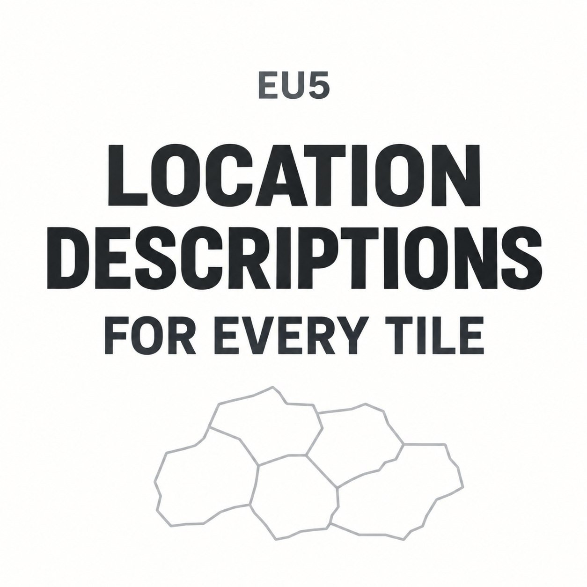

# Location Descriptions for Every Tile

[简体中文](README.zh-CN.md)

Historical and geographical descriptions for the places EU5 leaves blank. English and Simplified Chinese are included in the same mod.

Game version 1.3 has 28,511 locations. This mod adds descriptions to the 28,254 without vanilla text and leaves the 257 existing vanilla descriptions alone. Coverage includes cities, towns, countryside, mountains, sea zones and lakes.

## Getting started

Subscribe on the Steam Workshop, wait for the download to finish, then enable the mod in EU5's Mods and DLC menu. Set the game language to English or Simplified Chinese. You do not need a separate Chinese translation mod.

For a manual download, extract the ZIP and put the whole location_descriptions_enhanced folder, including its hidden .metadata folder, in EU5's user-data mod directory. Enable it in the game. Keep only one copy enabled; disable the old placeholder prototype if you used it.

Version 1.0.0. In-game and subscription checks are tracked in [release status](docs/RELEASE_READINESS.md).

## What to expect

Some places have a detailed local history; others have a shorter description of the surrounding region, landscape or waterways. The texts were drafted with AI assistance from published sources, mostly Wikipedia in English and the local language, then corrected and checked by the author, a geography enthusiast; city entries were checked fact by fact. Corrections and better local references are welcome.

The mod adds description text. It does not add events, change location names or alter gameplay rules. No other mod or DLC dependency is declared.

## Compatibility

Made for game version 1.3 (Steam build 26211608). Compatibility with achievements and multiplayer has not been tested.

Mods that replace the map or write the same location descriptions can conflict. This includes name/flavour mods that also contain descriptions: load order can give you one mod's English text and another's Chinese text. There is no tested compatibility patch yet.

See the [FAQ](docs/FAQ.md) and [compatibility notes](docs/COMPATIBILITY.md).

## Help improve a place

Found a wrong date, awkward translation or a place matched to the wrong location? Tell us in English or Chinese. A location name, region, screenshot and a useful source are enough to start; you do not have to know the internal ID.

Use this repository's Issues tab if available, or the Workshop comments and discussions. You can help without writing code or working in both languages. See [contributing](CONTRIBUTING.md).

## Source and build

The publishing project is separate from the research database. Content changes are reviewed in the research project and imported here; generated localization is not edited by hand. Source-checkout contributors can use tools/find_location.py to find the right record.

Python 3.10 or newer is enough; no additional packages or game installation are needed to build the frozen content:

    python -B tools/build.py --check
    python -B -m unittest discover -s tests -v
    python -B tools/build.py --output dist/my-candidate
    python -B tools/preflight.py --build dist/my-candidate --output dist/my-check.json

Use a new output directory for each build. The result includes the loadable mod folder, a ZIP and a checksum receipt. Build and publication details are in [PUBLISHING.md](docs/PUBLISHING.md).

## Credits and reuse

New descriptions and translations use **CC BY-SA 4.0**; tools and technical documentation use **MIT**. Keep the per-location source credits, identify changes and follow the applicable share-alike terms. See [LICENSE](LICENSE), [CREDITS.md](CREDITS.md) and [NOTICE.md](NOTICE.md).

The cover is an AI-assisted graphic, not a game screenshot. This is an unofficial community project, with no affiliation to Paradox, Valve or Wikimedia.
