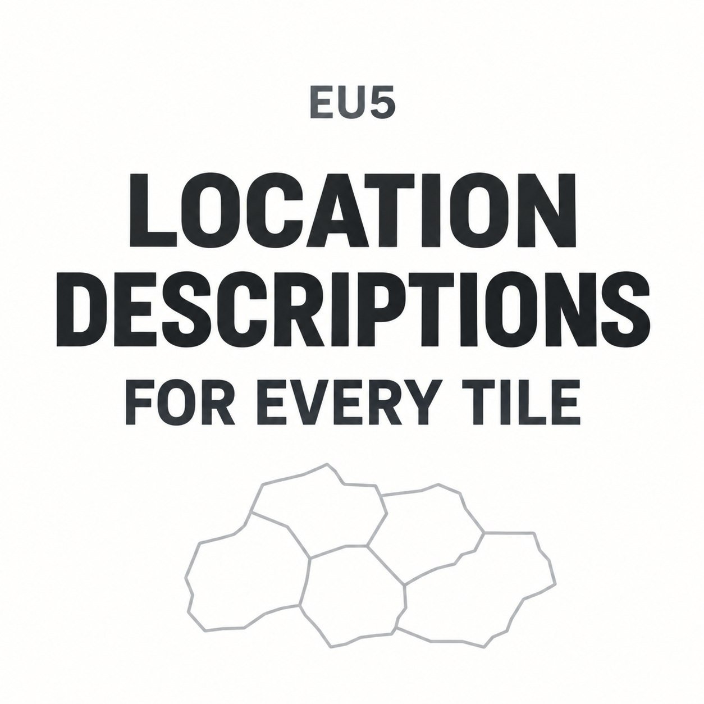

# 全地图地点介绍
## Location Descriptions for Every Tile

[English](README.md)

为 EU5 中原本没有介绍的地点补上历史与地理文本。英文、简体中文首发一起提供，订阅同一个模组即可，不需要另装汉化包。

当前基线共有 28,573 个地点。本模组补充其中 28,449 个，原版已有的 124 个介绍保持原文。范围包括城市、乡镇、乡村、山地、海域和湖泊。

## 怎么使用

在 Steam 创意工坊订阅，等待下载完成，再到游戏内“模组和 DLC”中启用。游戏语言选择英文或简体中文。

手动安装时，将 ZIP 中整个 location_descriptions_enhanced 文件夹放入 EU5 用户数据目录的 mod 文件夹，保留隐藏的 .metadata 目录，再在游戏中启用。如果用过之前的占位原型，先停用它；本地版和订阅版也不要同时启用。

当前为尚未发布的 Alpha 候选工程，完整正文包的实机和订阅检查仍待完成。最新进展见[发布状态](docs/RELEASE_READINESS.md)。

## 内容是什么样的

资料较充分的地点会介绍当地历史；部分地点只有简短介绍，或采用适用于该地区、地形与水域的背景。当前是 Alpha，尚未逐篇完成独立事实核验。正文是在查阅资料后由 AI 辅助撰写的，主要参考维基百科，欢迎纠错和补充可靠的地方资料。

模组只增加介绍文本，不新增事件、不改地名或玩法数值，也没有声明需要其他模组或额外 DLC。

## 兼容性

按 Steam build 24187685 准备。其他游戏版本、成就、联机和其他系统尚未确认兼容。

地图大修、修改同一地点介绍的模组可能冲突。有些地名或风味模组也包含介绍文本，不能仅凭名称判断互不影响。混用时，英文和中文还可能分别来自不同模组；目前没有经过验证的兼容补丁。

见[常见问题](docs/FAQ.zh-CN.md)和[兼容性说明](docs/COMPATIBILITY.md)。

## 想帮忙完善

如果发现年代有误、中文不通顺、地点认错，欢迎直接用中文或英文反馈。提供地点名称、所在地区、截图和资料链接即可，不知道内部 ID 也没关系。

可以使用本仓库的 Issues，或在工坊评论区、讨论区留言。不需要会写代码，也不要求一次把两种语言都改完。具体方式见[贡献指南](CONTRIBUTING.zh-CN.md)。

## 源码与构建

发布工程与原始研究库分开维护。正文修改审核后先回写研究工程，再导入这里；不要直接手改生成的本地化文件。使用源码的贡献者可以通过 tools/find_location.py 查找地点记录。

Python 3.10 以上即可构建当前冻结内容，无需游戏或额外依赖：

    python -B tools/build.py --check
    python -B -m unittest discover -s tests -v
    python -B tools/build.py --output dist/my-candidate
    python -B tools/preflight.py --build dist/my-candidate --output dist/my-check.json

每次构建使用新的输出目录，产物包含运行文件夹、ZIP 和哈希回执。发布操作见 [PUBLISHING.md](docs/PUBLISHING.md)。

## 来源与许可

新增介绍和翻译采用 **CC BY-SA 4.0**，工具及技术文档采用 **MIT**。再利用时请保留逐地点来源归属、标明修改，并遵守适用的相同方式共享要求。范围见 [LICENSE](LICENSE)、[CREDITS.md](CREDITS.md)及 [NOTICE.md](NOTICE.md)。

封面是 AI 辅助生成的图形，不是游戏截图。本项目为非官方社区模组，与 Paradox、Valve、Wikimedia 没有关联。
